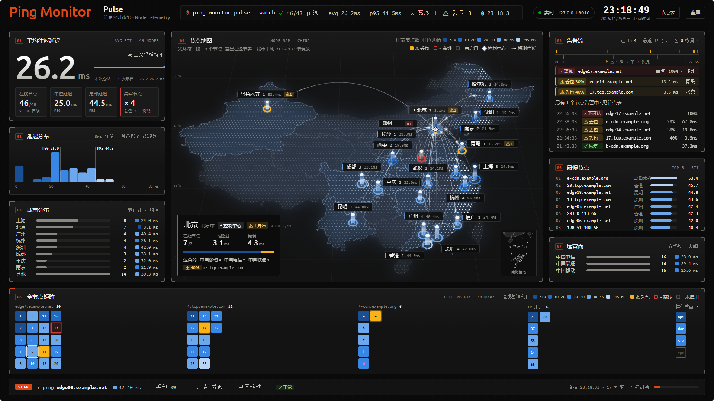
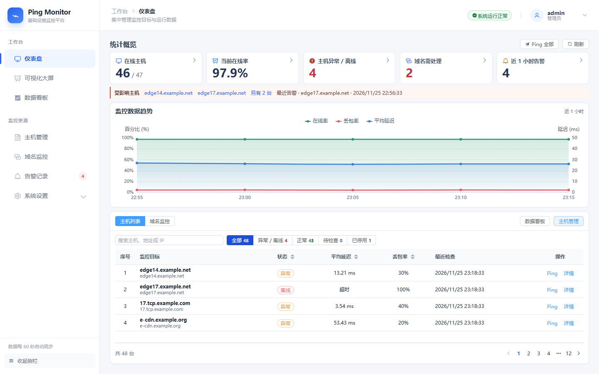
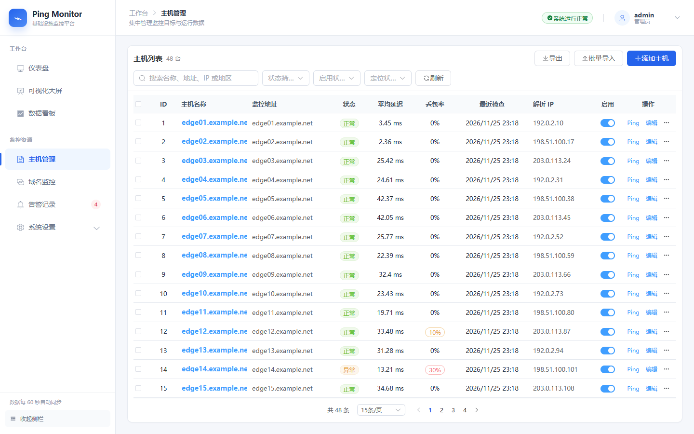
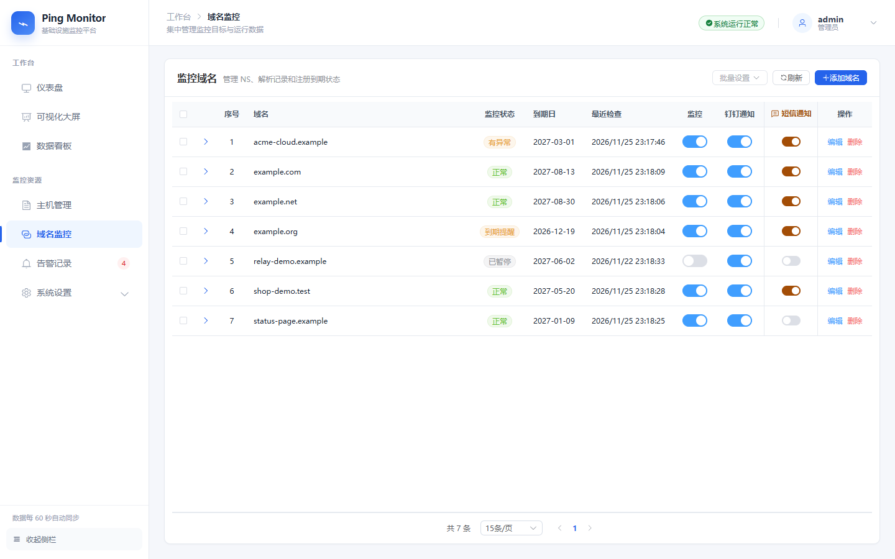
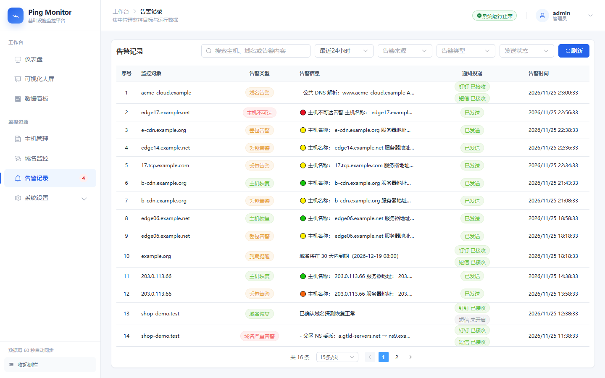
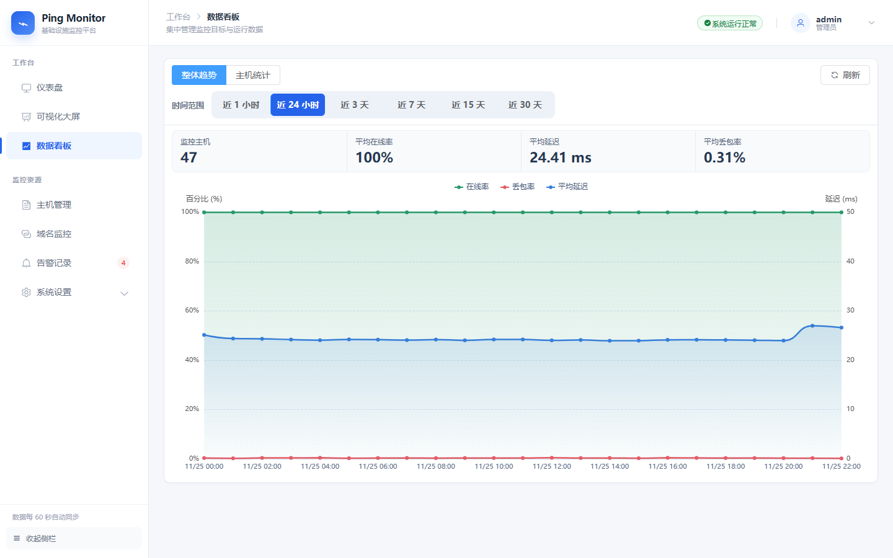
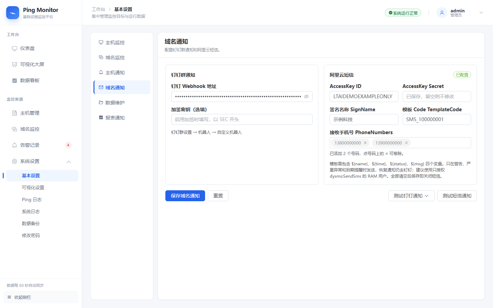
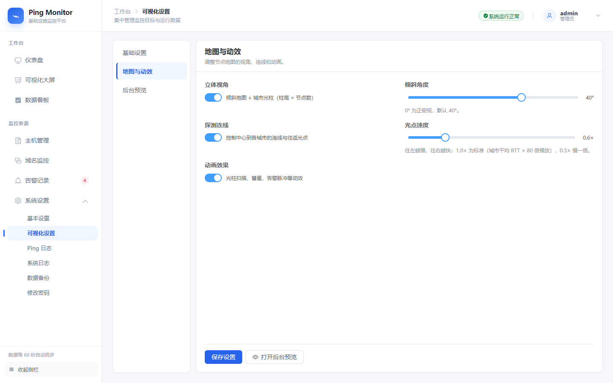

<div align="center">
  
  <h1>Ping Monitor</h1>
  <p>基于 FastAPI + Vue 3 + Element Plus 的主机连通性与域名解析监控系统</p>
  <p>Ping 检测、域名 NS / 解析 / 到期监控、钉钉与阿里云短信告警、节点态势大屏、数据看板，支持 Docker 双架构部署。</p>
  <p>
    
    
    
    
    
  </p>
  <p>
    
    
    
    
  </p>
  <p>
    <b>简体中文</b>
    ·
    <a href="README_EN.md">English</a>
  </p>
  <p>
    <a href="https://ping.774966.xyz"><b>🚀 在线演示</b></a>
    ·
    <a href="#快速开始">快速开始</a>
    ·
    <a href="#功能概览">功能概览</a>
    ·
    <a href="#docker-发布">Docker 发布</a>
    ·
    <a href="#更新日志">更新日志</a>
  </p>
  <p>
    <a href="https://github.com/JunWan666/ping-monitor/stargazers"></a>
    <a href="https://hub.docker.com/r/tannic666/ping-monitor"></a>
    
  </p>
</div>

---



<sub>节点态势大屏 · 倾斜点阵地图与城市光柱、控制中心往返探测、延迟分布、告警流、最慢节点与全节点矩阵</sub>

## 界面预览

| 仪表盘 | 主机管理 |
|:---:|:---:|
|  |  |

| 域名监控 | 告警记录 |
|:---:|:---:|
|  |  |

| 数据看板 | 域名通知（钉钉 + 阿里云短信） |
|:---:|:---:|
|  |  |

<sub>以上截图均来自虚构的演示数据：主机与域名使用 `example.*` 及保留后缀，地址使用 RFC 5737 文档专用网段，不含任何真实环境信息。</sub>

## 项目亮点

- **主机监控**：单台 / 批量 Ping，实时查看在线状态、延迟、丢包率，支持流式 Ping。
- **域名监控**：父区 NS 委派、注册局状态、到期日、权威 DNS 与公共 DNS 解析记录，异常按次数确认后再告警。
- **告警通知**：主机告警支持 Server 酱、钉钉、企业微信机器人；域名告警使用独立的钉钉机器人和阿里云短信；支持日报 / 周报 / 月报。
- **节点态势大屏**：独立页面，按 1920×1080 设计并自适应铺满，窄屏自动切换为纵向排版；无需任何第三方地图 Key。
- **数据看板**：`1h / 24h / 3d / 7d / 15d / 30d` 统计视图，聚合数据查询不回扫明细表。
- **地理位置增强**：域名解析、IP 定位、缺失位置自动补全、手动刷新。
- **部署简单**：本地启动、`docker compose`、Docker Hub 双架构镜像，MySQL / SQLite 均可。

## 功能概览

### 主机监控与告警

- 主机新增、编辑、删除、启停监控，导入 / 导出时携带地理位置。
- 立即 Ping、批量 Ping、流式 Ping；按状态变化或持续异常发送告警。
- 告警阈值按主机设置，丢包达到阈值记为异常，100% 丢包记为离线。
- 告警记录支持关键字搜索、来源 / 类型 / 发送状态筛选，主机与域名告警统一查看。

### 域名监控

详见 [docs/DOMAIN_MONITOR.md](docs/DOMAIN_MONITOR.md)。

- **委派**：直接询问父区服务器，核对 NS 是否与预期一致；两台父区同时返回不一致时立即告警。
- **注册状态与到期**：通过 RDAP 查询注册局状态和到期日，也可手动填写到期日；默认在 60、30、15、7、1 天及到期当天提醒。
- **解析记录**：A / AAAA / CNAME，泛解析每次使用随机子域名；权威 DNS 和公共 DNS 分别检查，CNAME 会继续验证能解析到 IP。
- **确认与提醒**：异常需连续确认（默认 2 次）才告警，持续故障按每个域名设置的间隔重复提醒，恢复后发送恢复通知。
- **通知渠道**：域名使用独立的钉钉机器人（不会回退到主机通知群）和可选的阿里云短信，每个域名可单独开关，桌面端可跨页批量设置。

### 告警通知渠道

| 场景 | 渠道 | 说明 |
| --- | --- | --- |
| 主机告警 | Server 酱 / 钉钉机器人 / 企业微信机器人 | 系统设置 → 基本设置 → 主机通知 |
| 域名告警 | 钉钉机器人（独立） | 支持加签；按模板发送警告、严重、恢复、到期四类通知 |
| 域名告警 | 阿里云短信 | SendSms（V3 签名），只发故障类通知；变量中的域名会自动转换以满足阿里云「变量不能含链接」的规定 |
| 报表 | 钉钉机器人（独立） | 日报 / 周报 / 月报，可设定发送时间 |

设置页的「测试钉钉通知」「测试短信通知」分别发送一条真实测试消息。

### 节点态势大屏

- 倾斜点阵中国地图，城市光柱高度表示节点数、颜色表示平均延迟；控制中心到各城市的连线上，光点往返节奏按城市平均 RTT 放慢。
- 平均延迟与变化趋势、延迟分布直方图、城市与运营商分布、实时告警流、最慢节点 TOP、按命名规律自动分组的全节点矩阵。
- 「可视化设置」可调整品牌名称、刷新间隔、游客访问、立体视角与倾斜角度、探测连线、光点速度和动画开关；系统开启「减少动态效果」时自动静态显示。
- 游客访问开启时，访问根路径直接进入大屏；后台「可视化大屏」使用登录态预览。

<details>
<summary>可视化设置截图</summary>



</details>

### 系统管理

- 管理员初始化、登录、修改密码。
- Ping 日志、系统日志筛选，数据维护任务（聚合、清理）日志。
- 数据库备份导出与导入恢复。

## 技术栈

| 层 | 组件 |
| --- | --- |
| 后端 | FastAPI · SQLAlchemy · APScheduler · ping3 · dnspython · Redis（可选） · MySQL / SQLite |
| 前端 | Vue 3 · Vue Router · Element Plus · ECharts · Axios · Vite |
| 大屏 | 独立的单文件页面（Canvas 绘制，内置中国地图数据与字体，不访问任何外网资源，无需地图 Key） |
| 部署 | Docker 多阶段构建 · `linux/amd64` + `linux/arm64` |

## 目录结构

```text
ping-monitor/
├── backend/                    # FastAPI 后端（主机监控、域名监控、通知、报表）
├── frontend/                   # Vue 管理后台
│   └── public/bigscreen/       # 节点态势大屏（独立页面）
├── docker/                     # Dockerfile、docker-compose 与 Docker 数据迁移脚本
├── docs/                       # 部署、域名监控等文档与截图
├── scripts/                    # 部署、升级、数据迁移与本地同步脚本
├── tests/                      # 后端与前端测试
├── data/                       # 运行时数据目录（SQLite、备份，不入库）
├── start.bat                   # Windows 本地启动脚本
└── README.md
```

## 快速开始

### 方式一：直接使用 Docker Hub 镜像

已发布镜像：

- `tannic666/ping-monitor:latest`
- `tannic666/ping-monitor:v1.7.0`
- `tannic666/ping-monitor:v1.5.0`

镜像平台：`linux/amd64`、`linux/arm64`。单容器模式默认使用 SQLite，数据保存在挂载目录中。

```bash
docker run -d \
  --name ping-monitor \
  -p 8000:8000 \
  -v "$(pwd)/data:/app/data" \
  -e TZ=Asia/Shanghai \
  --restart unless-stopped \
  tannic666/ping-monitor:latest
```

Windows PowerShell：

```powershell
docker run -d `
  --name ping-monitor `
  -p 8000:8000 `
  -v "$PWD/data:/app/data" `
  -e TZ=Asia/Shanghai `
  --restart unless-stopped `
  tannic666/ping-monitor:latest
```

访问地址：

- 系统首页：`http://localhost:8000`
- OpenAPI 文档：`http://localhost:8000/docs`

### 方式二：使用 docker compose

适合需要 `MySQL + Redis` 的完整部署方式。

```bash
docker compose -f docker/docker-compose.yml up -d
```

重新构建：

```bash
docker compose -f docker/docker-compose.yml up -d --build
```

使用预构建镜像：

```bash
export PING_MONITOR_IMAGE=tannic666/ping-monitor:v1.7.0
docker compose -f docker/docker-compose.yml up -d
```

Windows PowerShell：

```powershell
$env:PING_MONITOR_IMAGE="tannic666/ping-monitor:v1.7.0"
docker compose -f docker/docker-compose.yml up -d
```

### 方式三：本地开发

```bash
# 后端
cd backend
pip install -r requirements.txt
python main.py

# 前端（另开终端）
cd frontend
npm install
npm run dev
```

开发环境访问地址：

- 前端：`http://localhost:5173`
- 后端：`http://localhost:8000`
- API 文档：`http://localhost:8000/docs`

## 环境变量

| 变量名 | 说明 | 默认值 |
| --- | --- | --- |
| `TZ` | 容器时区 | `Asia/Shanghai` |
| `DATABASE_URL` | 数据库连接地址 | 默认 SQLite |
| `REDIS_URL` | Redis 连接地址 | 空 |
| `ENABLE_CACHE` | 是否启用缓存 | `true` |
| `JWT_SECRET_KEY` | JWT 密钥，生产环境务必修改 | 内置默认值 |
| `CACHE_TTL_DASHBOARD` | 仪表盘缓存秒数 | `15` |
| `CACHE_TTL_DATABOARD` | 数据看板缓存秒数 | `45` |
| `CACHE_TTL_HOST_DETAIL` | 主机详情缓存秒数 | `30` |
| `DISABLE_NOTIFICATIONS` | 禁用所有外部通知（钉钉、Server 酱、企业微信、短信、报表），适合本地复刻线上数据 | `false` |
| `ALLOW_TEST_NOTIFICATIONS` | 在 `DISABLE_NOTIFICATIONS=true` 时仍允许管理员手动点「测试钉钉通知 / 测试短信通知」；自动告警照样不发 | `false` |
| `DISABLE_SCHEDULER` | 禁用后台定时监控与维护任务，适合本地调试 | `false` |
| `DISABLE_HOST_MONITOR` | 暂停主机定时 Ping，保留域名探测 | `false` |

项目根目录可通过 `.env` 管理本地启动参数，示例见 `.env.example`。

### 本地复刻线上数据

仓库提供了本地同步脚本，方便把线上 MySQL 数据导入本地复刻问题；脚本会自动清空本地通知配置（主机、域名、报表的钉钉地址与密钥，Server 酱，阿里云短信 AccessKey、签名、模板和手机号），清空后核对一遍，仍有残留就不启动本地应用；同时写入 `DISABLE_NOTIFICATIONS=true`、`DISABLE_SCHEDULER=true`，避免本地调试时误发钉钉、短信或报表通知。

```powershell
powershell -ExecutionPolicy Bypass -File .\scripts\sync-prod-to-local.ps1
```

## 使用说明

### 首次访问

- 如未初始化管理员，系统会引导进入初始化页面。
- 初始化完成后使用管理员账号登录后台。
- 开启大屏游客访问时，访问 `8000` 根路径直接进入大屏；关闭时进入登录页。

### 主机导入导出与地理位置

- 导入支持主机名称、地址、描述、告警阈值及地理位置；导出带出当前定位结果。
- 关闭「自动刷新地理位置」时，已有位置不反复覆盖，缺失位置会自动补齐；开启后监控过程中持续刷新。
- 支持在后台手动刷新单台主机的 IP 和地理位置。

### 域名监控与通知

1. 「域名监控」添加注册域名，可先「查询当前 NS」，再核对注册商后台的预期 NS；有关键业务时建议再加解析记录检查。
2. 「系统设置 → 基本设置 → 域名监控」调整检查间隔、确认次数和到期提醒节点。
3. 「系统设置 → 基本设置 → 域名通知」配置钉钉机器人和阿里云短信（AccessKey ID / Secret、签名、模板 Code、接收手机号）。
4. 在域名列表为需要的域名打开「钉钉通知」「短信通知」。

阿里云短信模板需包含 `${name}`、`${time}`、`${status}`、`${msg}` 四个变量，建议使用只授权 `dysms:SendSms` 的 RAM 用户。完整说明见 [docs/DOMAIN_MONITOR.md](docs/DOMAIN_MONITOR.md)。

## API 概览

<details>
<summary>展开查看主要接口</summary>

### 认证

- `POST /api/auth/init`
- `POST /api/auth/login`
- `GET /api/auth/me`
- `PUT /api/auth/update-password`

### 主机管理

- `GET /api/hosts`
- `POST /api/hosts`
- `PUT /api/hosts/{id}`
- `DELETE /api/hosts/{id}`
- `POST /api/hosts/{id}/refresh-ip`
- `POST /api/hosts/{id}/refresh-location`

### 监控、告警与日志

- `POST /api/ping/{id}`
- `GET /api/ping-stream/{id}`
- `POST /api/ping-all`
- `GET /api/ping/logs`
- `GET /api/alerts`（主机与域名告警，含各渠道投递状态）
- `GET /api/system-logs`

### 域名监控

- `GET /api/domains` · `POST /api/domains` · `PUT /api/domains/{id}` · `DELETE /api/domains/{id}`
- `PATCH /api/domains/{id}/state` · `PATCH /api/domains/bulk-state`
- `POST /api/domains/discover`（查询当前 NS）
- `GET /api/domains/settings` · `PUT /api/domains/settings`
- `GET /api/domains/notification` · `PUT /api/domains/notification` · `GET /api/domains/notification/status`
- `POST /api/domains/notification/test`（钉钉）· `POST /api/domains/notification/sms/test`（短信）

### 数据看板与大屏

- `GET /api/dashboard`
- `GET /api/databoard/stats/{timeRange}`
- `GET /api/databoard/host/{hostId}/{timeRange}`
- `GET /api/public/datascreen/status`
- `GET /api/public/datascreen`
- `GET /api/public/alerts`
- `GET /api/datascreen/preview`
- `GET /api/datascreen/config` · `PUT /api/datascreen/config`

### 报表与数据维护

- `POST /api/reports/{report_type}/send`
- `POST /api/database/export` · `GET /api/database/export/{job_id}/download`
- `POST /api/database/import`

</details>

## 相关文档

- 域名监控与通知：[docs/DOMAIN_MONITOR.md](docs/DOMAIN_MONITOR.md)
- Debian 11 Docker 部署教程：[docs/DEPLOYMENT_DOCKER_DEBIAN11.md](docs/DEPLOYMENT_DOCKER_DEBIAN11.md)
- MySQL + Redis 部署说明：[docs/DEPLOYMENT_MYSQL_REDIS.md](docs/DEPLOYMENT_MYSQL_REDIS.md)
- 一键部署脚本：`scripts/deploy-docker-debian11.sh`
- SQLite 迁移到 MySQL：`scripts/migrate_sqlite_to_mysql.py`

## Docker 发布

当前版本提供双架构镜像构建方式：

```bash
docker buildx build \
  --platform linux/amd64,linux/arm64 \
  -f docker/Dockerfile \
  -t tannic666/ping-monitor:v1.7.0 \
  -t tannic666/ping-monitor:latest \
  --provenance=false \
  --sbom=false \
  --push \
  .
```

## 更新日志

### 未发布

- 新增域名监控：父区 NS 委派、注册局状态与到期提醒、权威 / 公共 DNS 解析记录检查，异常确认后告警，支持跨页批量设置。
- 域名告警支持独立钉钉机器人和阿里云短信（SendSms V3 签名），设置页可分别发送钉钉、短信测试；接收手机号改为回车添加、可删除的标签。
- 节点态势大屏重做：倾斜点阵地图与城市光柱、往返探测光点（速度可调）、延迟分布、告警流、全节点矩阵；按命名规律自动分组，不再内置任何部署环境的命名；窄屏纵向排版；字体随项目内置，不再请求 Google Fonts，内网和国内网络下也不会因字体加载而白屏。
- 告警记录统一展示主机与域名告警及各渠道投递状态，补充「主机恢复」类型标签与筛选。
- 页面返回 `Cache-Control: no-cache`，升级后浏览器不会继续显示旧版本页面。
- 新增 `ALLOW_TEST_NOTIFICATIONS` 与 `DISABLE_HOST_MONITOR`；本地同步脚本会清空域名钉钉与短信凭据。

### v1.7.0 (2026-09-23)

- 大屏通用化：移除生产环境敏感信息与第三方品牌标识，控制中心按节点重心自动计算。
- 节点数据加载路径修正，示例数据与文案不再出现真实服务域名。
- PC 端交互补齐（鼠标拖拽 / 双击放大），移动端底部导航改固定定位，地图支持拖动平移。
- 修复内置矢量引擎地图左右镜像、刷新闪烁、滚轮缩放与高德视野重置问题。
- 新增 GitHub Actions 自动构建 `linux/amd64` / `linux/arm64` 双架构镜像。
- 文档：新增在线演示入口与界面截图。

### v1.6.0 (2026-05-18)

- 发布 `tannic666/ping-monitor:v1.7.0` 双架构镜像，支持 `linux/amd64` 与 `linux/arm64`。
- 仪表盘与主机管理改为优先读取 `hosts` 表上的最新 Ping 指标，避免每次从百万级明细表回查最新记录。
- Ping 写入链路同步维护 `last_packet_loss`、`last_avg_rtt`、`last_check`，旧库启动时会自动回填历史最新状态。
- 数据看板在命中 `ping_statistics` 聚合数据后不再额外回扫原始 `ping_records`，大幅降低 1d/7d 等统计接口耗时。
- 新增 `ping_records(host_id, id)` 复合索引，优化旧数据回填和最新记录兜底查询。
- 新增 `DISABLE_NOTIFICATIONS` 与 `DISABLE_SCHEDULER` 本地安全开关，方便复刻线上数据时禁用钉钉通知和定时任务。
- 新增 `scripts/sync-prod-to-local.ps1`，支持一键导出线上 MySQL 数据、导入本地并清空本地通知配置。
- Docker Compose 默认补充本地安全开关透传，并收紧 MySQL/Redis 本地端口绑定配置。

### v1.5.0 (2026-04-22)

- 新增可视化大屏配置页、游客访问开关、全屏按钮与预览入口。
- 重构可视化大屏，支持中国/全球地图、监控中心、区域染色、飞线、悬停与固定详情。
- 新增监控中心公网 IP 自动识别与动态定位。
- 新增 `ip_location_service`，优化国内 IP 定位结果，优先整合百度 Qifu 等数据源。
- 支持主机地理位置自动补全、自动刷新策略、手动刷新 IP/位置。
- 主机导入导出增强，兼容地理位置字段。
- 仪表盘、主机管理、告警记录、系统日志补充搜索、筛选与操作入口。
- 优化钉钉报表配置布局与后台整体交互体验。
- 修复菜单切换偶发白屏，为异步模块加载增加自动重试与刷新兜底。
- 保持 Docker 镜像支持 `linux/amd64` 与 `linux/arm64` 双架构发布。

### v1.4.0

- 自动数据库结构同步。
- 仪表盘数据点配置增强。
- 数据维护与日志展示优化。

### v1.3.0

- 新增数据看板。
- 新增系统日志与数据维护任务。
- 新增通知配置与维护配置优化。

### v1.2.0

- 通知模板重构。
- 支持修改密码。
- 导入导出与筛选体验优化。

### v1.1.0

- 新增 JWT 登录认证。
- 新增管理员初始化流程。

### v1.0.0

- 首个可用版本发布。

## 许可证

Apache-2.0 License

大屏内置的 Ubuntu / Ubuntu Mono 字体遵循 [Ubuntu Font Licence 1.0](frontend/public/bigscreen/fonts/UFL.txt)。

---

<div align="center">

**如果这个项目对你有帮助，欢迎点个 ⭐ Star 支持一下～**

[](https://star-history.com/#JunWan666/ping-monitor&Date)

</div>
