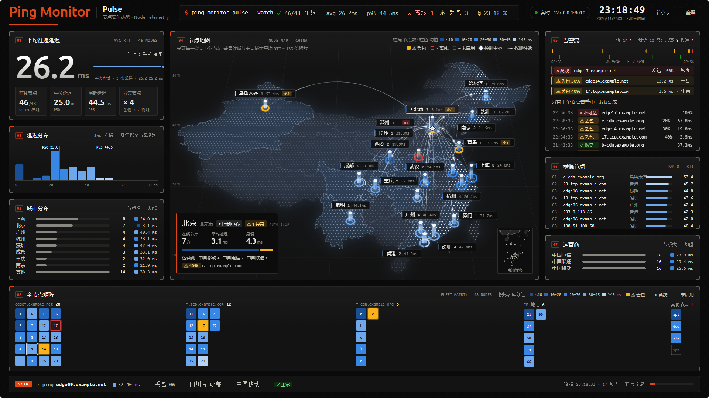
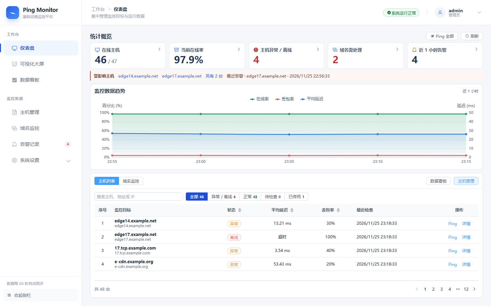
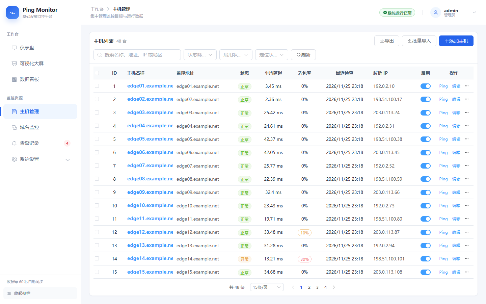
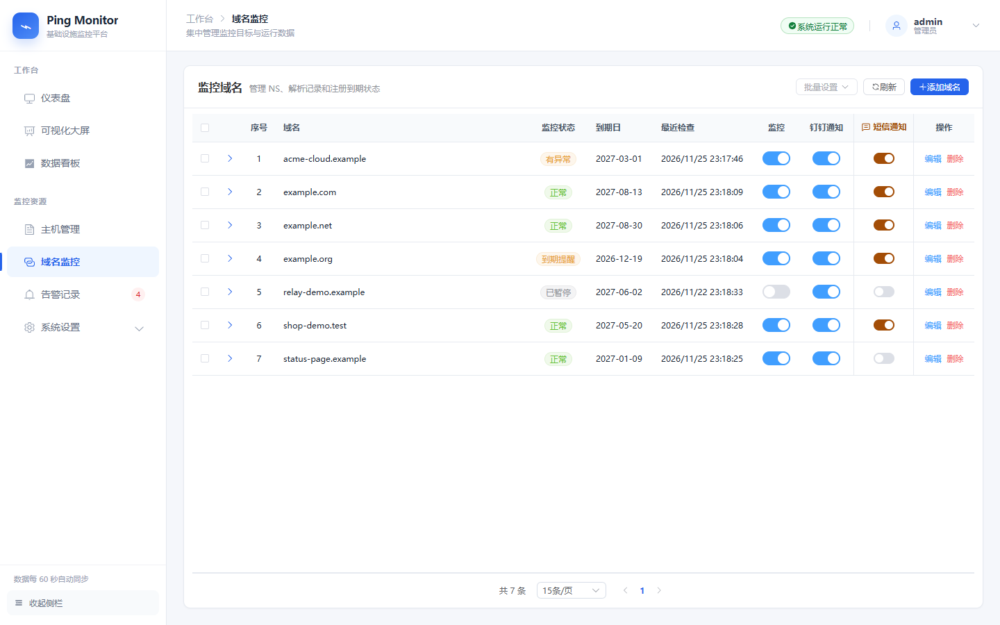
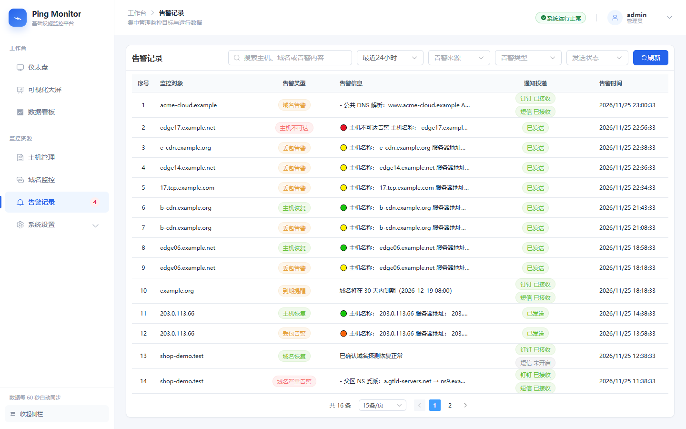
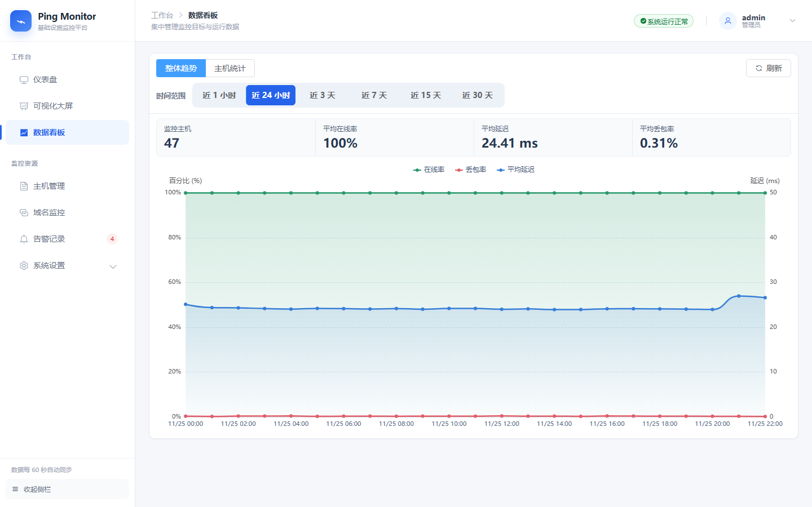
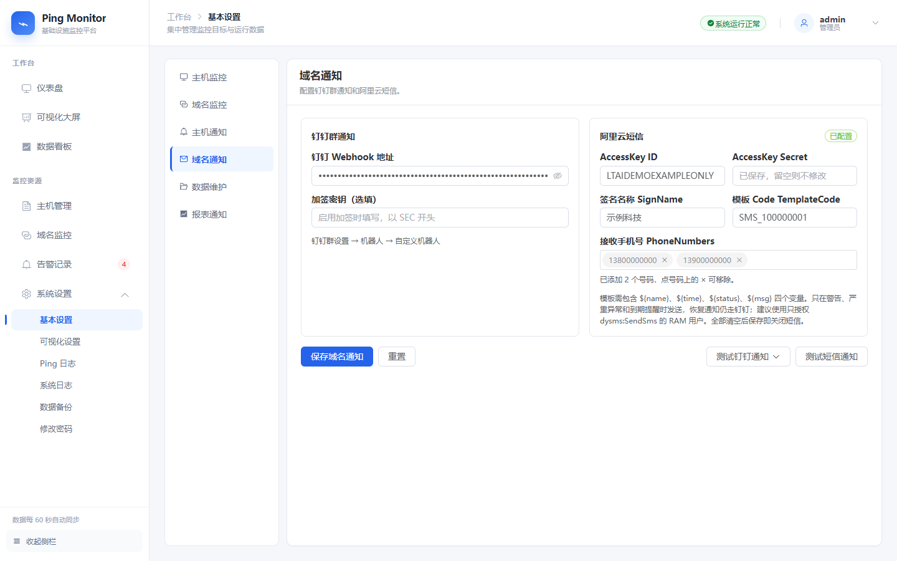

<div align="center">
  
  <h1>Ping Monitor</h1>
  <p>A self-hosted host connectivity and domain DNS monitoring system</p>
  <p>Automated ICMP ping checks · domain NS / DNS / expiry checks · node telemetry wall screen · DingTalk &amp; Alibaba Cloud SMS alerts</p>
  <p>
    
    
    
    
    
  </p>
  <p>
    
    
    
  </p>
  <p>
    <a href="README.md">简体中文</a>
    ·
    <b>English</b>
  </p>
  <p>
    <a href="https://ping.774966.xyz"><b>🚀 Live Demo</b></a>
    ·
    <a href="#quick-start">Quick Start</a>
    ·
    <a href="#features">Features</a>
    ·
    <a href="#documentation">Documentation</a>
  </p>
  <p>
    <a href="https://github.com/JunWan666/ping-monitor/stargazers"></a>
    <a href="https://hub.docker.com/r/tannic666/ping-monitor"></a>
    
  </p>
</div>

---



<sub>Node telemetry wall screen · tilted dot-matrix map with city pillars, control-centre round trips, latency histogram, alert stream, slowest nodes and the full fleet matrix</sub>

## Screenshots

| Admin Dashboard | Host Management |
|:---:|:---:|
|  |  |

| Domain Monitoring | Alert Records |
|:---:|:---:|
|  |  |

| Statistics Board | Domain Notifications (DingTalk + SMS) |
|:---:|:---:|
|  |  |

<sub>All screenshots use fictional demo data: `example.*` and reserved names, RFC 5737 documentation addresses, nothing from a real deployment.</sub>

## Features

| Module | Description |
|---|---|
| 🎯 **Host Monitoring** | Single / batch host monitoring with live online status, latency and packet loss. Enable/disable, ping now, streaming ping |
| 🌐 **Domain Monitoring** | Parent-zone NS delegation, registry status and expiry (RDAP or manual date), authoritative and public DNS record checks (A / AAAA / CNAME, wildcards); anomalies are confirmed before alerting |
| 📊 **Statistics Board** | `1h / 24h / 3d / 7d / 15d / 30d` views with latency and packet-loss trend charts |
| 🗺️ **Wall Screen** | Standalone 1920×1080 page that fills any screen and stacks on phones: tilted China map with city pillars, comet round trips (adjustable speed), latency histogram, alert stream, fleet matrix grouped by naming pattern; no map API key needed |
| 🌏 **Geo Location** | Automatic domain→IP resolution, multi-source IP geolocation, auto-complete of missing locations |
| 🔔 **Alerts** | Hosts: ServerChan, DingTalk or WeCom robot. Domains: a dedicated DingTalk robot plus optional Alibaba Cloud SMS (SendSms, V3 signature). Daily / weekly / monthly reports |
| 🛠️ **Admin Console** | Fuzzy search, status filters, pagination, import/export, Ping and system logs, database backup &amp; restore |
| 🐳 **Easy Deployment** | Local run / `docker compose` / multi-arch Docker Hub image (`amd64` + `arm64`) |

## Quick Start

### Option 1 · Docker Compose (MySQL + Redis)

```bash
git clone https://github.com/JunWan666/ping-monitor.git
cd ping-monitor/docker
docker compose up -d
```

Open `http://localhost:8000` — the first visit guides you through creating an admin account.

### Option 2 · Single container (SQLite, lightweight)

```bash
docker run -d --name ping-monitor \
  -p 8000:8000 \
  -v $PWD/data:/app/data \
  -e DISABLE_NOTIFICATIONS=true \
  tannic666/ping-monitor:v1.7.0
```

### Option 3 · Local development

```bash
# Backend
cd backend && pip install -r requirements.txt && python main.py

# Frontend (new terminal)
cd frontend && npm install && npm run dev
```

## Why Ping Monitor?

| Capability | Ping Monitor | Uptime Kuma | Gatus |
|---|:---:|:---:|:---:|
| ICMP ping latency / packet-loss focus | ✅ | Partial | Partial |
| Domain NS delegation / DNS / expiry checks | ✅ | Partial | Partial |
| Map wall screen for a node fleet | ✅ | ❌ | ❌ |
| Automatic IP geolocation | ✅ | ❌ | ❌ |
| Host import / export | ✅ | Partial | ❌ |
| Chinese UI built-in | ✅ | i18n | i18n |
| Deployment | Docker / bare metal | Docker | Docker |

## Tech Stack

**Backend** · FastAPI · SQLAlchemy · APScheduler · ping3 · dnspython · Redis (optional) · MySQL / SQLite
**Frontend** · Vue 3 · Vue Router · Element Plus · ECharts · Vite
**Wall screen** · Standalone single-file page drawn on Canvas, with bundled China map data and fonts (no external requests)
**Deploy** · Multi-stage Docker build · `linux/amd64` + `linux/arm64`

## Documentation

Full documentation is currently in Chinese — see the [Chinese README](README.md):

- [Domain monitoring and notifications](docs/DOMAIN_MONITOR.md)
- [Deployment on Docker + Debian 11](docs/DEPLOYMENT_DOCKER_DEBIAN11.md)
- [MySQL + Redis deployment](docs/DEPLOYMENT_MYSQL_REDIS.md)
- [Environment variables](README.md#环境变量) · [API overview](README.md#api-概览)

## License

[Apache-2.0](LICENSE)

The Ubuntu / Ubuntu Mono fonts bundled with the wall screen are under the [Ubuntu Font Licence 1.0](frontend/public/bigscreen/fonts/UFL.txt).

---

<div align="center">

**If this project helps you, please consider giving it a ⭐ Star — it really helps!**

[](https://star-history.com/#JunWan666/ping-monitor&Date)

</div>
